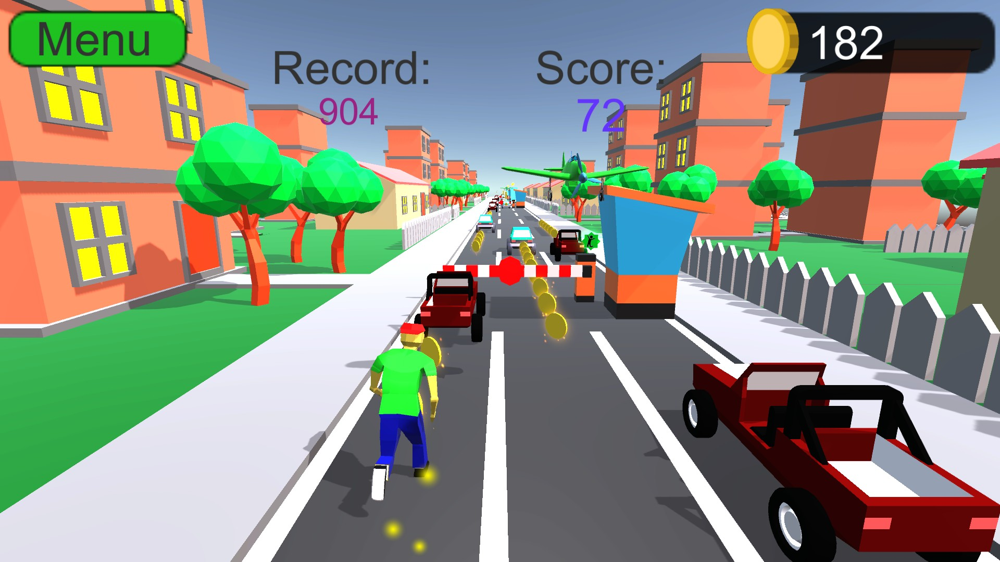
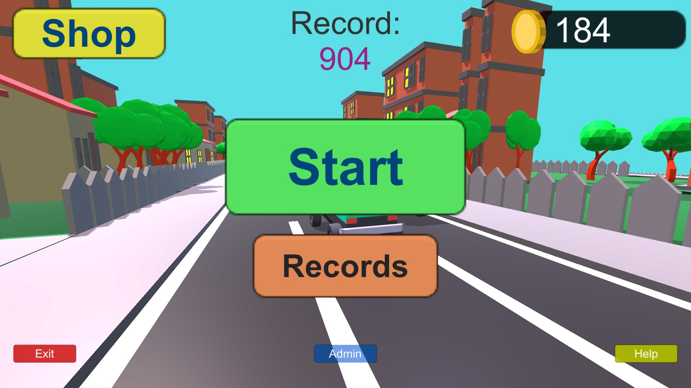

# Low-poly Endless Runner

Бесконечный раннер для ПК на Unity и C#. Один из моих первых полноценных проектов, 2023 год. Код, модель персонажа, анимации в Blender и музыку в FL Studio делал сам.

**[Запись геймплея](https://youtu.be/6OBkhfu0dME)**

## Что есть в игре

- Трасса из заранее подготовленных паттернов, препятствия и пролетающий самолёт
- Монеты, бонусы и воскрешение за монеты
- Таблица рекордов и сохранение баланса
- Магазин скинов и карт

## Как запустить

Откройте проект в Unity 2021.3.26f1, затем сцену "Assets/Scenes/Menu.unity" и нажмите "Play". Управление осуществляется стрелками или свайпами мышью (есть раздел в главном меню "Help" с подсказками).
